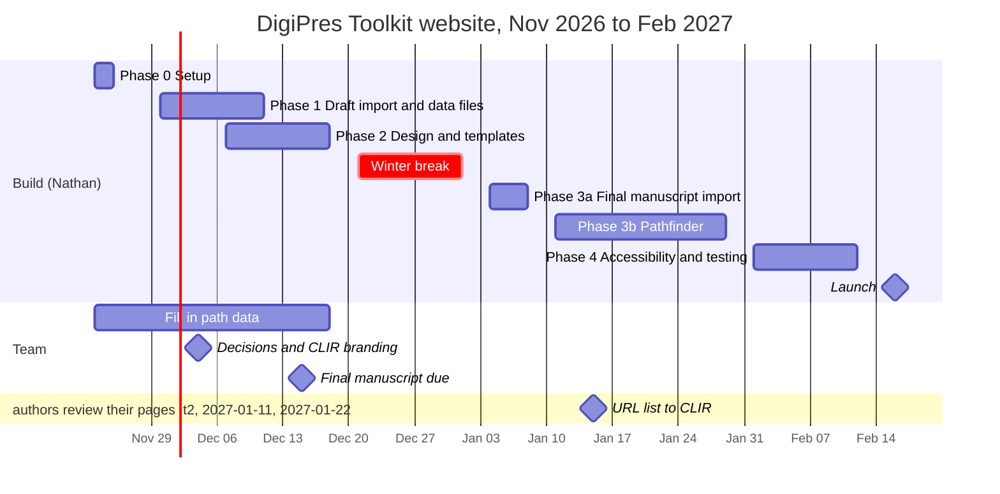

# DigiPres Toolkit Website: Project Plan

*Updated November 17, 2026 · Nathan Tallman*

We are building Concept C, "Start Where You Are," as a static Hugo site in a public repository in the APTrust GitHub organization. It is published on GitHub Pages at **digipres.guide**. The site goes live in mid-February 2027, after the final manuscript is imported in January. Its URLs are frozen earlier, so CLIR's PDF can link to them.

## Decisions made

| Decision | Choice |
| --- | --- |
| Site concept | C: Start Where You Are (pathfinder home page, full toolkit one click away) |
| Generator | Hugo, pinned to one exact version in GitHub Actions |
| Repository | Public, in the APTrust GitHub organization, with project members added at the repo level |
| Hosting | GitHub Pages at `digipres.guide`, registered through Cloudflare (see [Domain](#domain)) |
| JavaScript | Hand-written, no libraries. Every path is also a static page. |
| Search | Pagefind (standalone binary) |
| PDF | None from us. CLIR produces the official PDF, and the site links to it. |
| Feedback | A simple form on the site that submits to a Google Form, with responses in a Google Sheet. Both live in an APTrust shared drive managed by Nathan and Biz (see [Feedback form](#feedback-form)). |
| Analytics | Matomo, cookieless, with a privacy-respecting report of path choices (see [Analytics](#analytics)) |
| Accessibility | WCAG 2.2 AA |
| Revisions after launch | None planned. The site launches as v1.0 and gets maintenance only. |
| Branding | Pending CLIR's answer. The working assumption is our own identity with a CLIR credit. |

The toolkit's four phases are **LEARN** (concepts and risks), **READY** (organizational development and preparation), **CURATE** (initial preservation actions), and **PRESERVE** (long-term practices). These names are also the site's top-level sections and the first part of every URL, as in `/learn/`, `/ready/`, `/curate/`, and `/preserve/`.

## Scope

**In scope for launch**

- **Pathfinder:** two questions (what you are working with, what you can put toward it). Every answer combination gets its own static, shareable page at `/start/<situation>/<level>/`.
- **Full toolkit:** the introduction, LEARN, READY, CURATE, PRESERVE, and the conclusion, with one page per section and stable URLs.
- **Checklists:** interactive, with progress saved in the reader's own browser, plus a print-friendly worksheet view.
- **Glossary:** a glossary page and a searchable side panel, with each definition credited to its source (SAA, DPC, FADGI) and terms linked from the text.
- **Tools directory:** filterable by workflow step and platform.
- **Further reading and works cited.**
- **Site basics:** search, a feedback form, an "Edit this page on GitHub" link, last-updated dates, a link to CLIR's PDF once it exists, and an about and credits page.

**Out of scope:** PDF or EPUB output, user accounts, any server of our own, translations, and planned revisions after v1.0.

## Schedule

The final manuscript is due **December 15**, the same week winter breaks begin. Work that needs the team (path data, decisions) is due before the break. January is for the final-manuscript import and the pathfinder, while section authors review their pages.

| Phase | Dates | What happens | Gate |
| --- | --- | --- | --- |
| 0. Setup | Nov 23 to 25 | Repo in the APTrust org, pinned Hugo, Actions deploy to Pages, `digipres.guide` DNS and HTTPS, content license | |
| 1. Draft import and data files | Nov 30 to Dec 11 | Import script (pandoc) turns the Nov 10 draft into pages. First drafts of `tools.yaml` and `glossary.yaml`. Converter from the path data sheet to `paths.yaml`. | Path data template goes to the team in Phase 0 |
| 2. Design and templates | Dec 7 to 18 | Theme, section pages, glossary, tools directory, checklists, search, feedback form | Decisions and CLIR branding answer by **Dec 4** |
| Winter break | Dec 21 to Jan 1 | | Path data due **Dec 18** · Final manuscript due **Dec 15** |
| 3a. Final manuscript import | Jan 4 to 8 | Re-run the import on the final .docx and open one pull request with the full diff | |
| 3b. Pathfinder | Jan 11 to 29 | Path pages generated from `paths.yaml`, in-place switching, framing copy, Matomo events | URL list to CLIR by **Jan 15** |
| 4. Accessibility and testing | Feb 1 to 12 | WCAG 2.2 AA audit, keyboard and screen reader passes, a few practitioner walkthroughs | Section authors' review done by **Jan 22** |
| Launch | Week of Feb 15 | Tag v1.0, point the domain, announce | |

The break dates are assumptions; the team should confirm them. If path data slips past December 18, the pathfinder launches with the situations that are ready.

### Launching before the CLIR PDF

We expect the site to go live before CLIR publishes, and that's fine. For the PDF to link to the site, what matters is that **URLs are final** before CLIR locks the PDF, not that the site is public. So:

1. The domain is settled: `digipres.guide` is registered.
2. After the final manuscript is imported (Jan 8), we freeze the URL map and send CLIR the list of section URLs by January 15.
3. The site can run at its real domain before launch. Search engines are blocked until launch day if we want a quieter preview.
4. When CLIR publishes, we add the PDF link (and DOI, if there is one) to every section page in one small change.

If CLIR's schedule lets both go out together, we hold the announcement until publication day.

## Path data

The pathfinder can't be built without the path data, and none of it is in the manuscript yet. The template is [`path-data-template.xlsx`](path-data-template.xlsx). Upload it to Google Drive and open it as a Google Sheet so the team can work on it together. Everyone on the team is a path data author. Each person takes ownership of one or more situations on the Situations tab.

| Tab | What goes in it |
| --- | --- |
| Start here | Instructions and rules (IDs, blurb length, how to list tools) |
| Levels | Resource levels: title, budget, staff time, IT access, copies goal |
| Situations | Starting situations: title, one-line description, owner, optional effort |
| Steps | Ordered steps per situation: title, blurb, toolkit section, tools, and whether it varies by level |
| Level variations | For steps that vary: what the reader sees, and which storage, at each level |
| Framing copy | Home page intro, the "this is one route" note, the closing "good is good enough" message |
| Storage options, Tools, Sections | Reference lists for the dropdowns. Add rows as needed. |

The grey italic rows are examples from the concept mockup. Sections are keyed to the November 10 draft under the four phase names. If the final manuscript renames a section, keep its ID and change only its title.

In Phase 1, Nathan writes a small converter that reads the sheet (downloaded as .xlsx) and writes `data/paths.yaml`, `data/tools.yaml`, and the storage list. It stops with a clear error if a step points to a section, tool, or level that doesn't exist. Re-running it after any sheet edit updates the site.

**Also needed from the team before the break**

- [ ] Glossary: the final term list, and which source's definition to show for each term. Also confirm we may quote SAA, DPC, and FADGI definitions on a public site, and what attribution each needs.
- [ ] Figures: source files (SVG preferred) and alt text for the cycle diagram and the two workflow diagrams. If none exist, we'll redraw them.
- [ ] Tools tab: check URLs and notes for the tools you know.
- [ ] CLIR: whether Pocket Burgundy branding is required.
- [ ] A content license (for example, CC BY 4.0).

## Final manuscript import

The import script is written in Phase 1 against the draft, so the final pass (Jan 4 to 8) is mostly a rerun plus review.

1. **Receive the final .docx** (Dec 15). Site text is frozen until the import merges.
2. **Re-run the import.** pandoc converts the .docx to Markdown, splits it into one page per section, and drops working material (outline, author assignments, timeline).
3. **Open one pull request.** The diff shows every change from draft to final, section by section.
4. **Keep URLs stable.** A heading-to-URL map keeps each page's address. Anything that moves gets a redirect (a Hugo alias).
5. **Reconcile the path data.** The build fails if a path step links to a section that was renamed or removed. We fix those failures in the sheet's Sections tab and re-run the converter.
6. **Section authors review their own pages** (Jan 11 to 22) on the preview site.
7. **Freeze URLs and send the list to CLIR** (Jan 15).

The draft has issues the final manuscript should settle, because the site depends on them:

- The cycle figure describes five stages (Prepare, Curate, Check, Transfer, Save & Maintain), but the CURATE text has four headings, and Check has no heading of its own.
- The phase names now read LEARN, READY, CURATE, and PRESERVE. The conclusion still says CREATE.
- Several passages are unfinished, including the political shifts bullet, the ransomware sentence, and the recommended reading under Program Benchmarking.

## Feedback form

Readers send feedback through a short form styled like the rest of the site: which page, what's wrong or what they'd suggest, and an optional email. Behind it is a Google Form owned by the team, so there are no GitHub accounts, no tokens, and no second repository. Responses stay private, in a Google Sheet only the team can see.

1. Nathan creates the Google Form and its response Sheet in an **APTrust shared drive**, not in anyone's My Drive, so the files belong to APTrust rather than to a person. Nathan and Biz are both Managers of that shared drive. The questions match the site's form. Turn on email notifications for new responses.
2. The site's form posts each field straight to the Google Form's `formResponse` address. The page URL is filled in automatically.
3. The site shows its own "Thanks, we got it" message. Google doesn't confirm success to an outside page, so the message says the feedback was sent rather than claiming it arrived.
4. Without JavaScript, the form still posts, and the reader lands on Google's standard confirmation page.
5. A hidden honeypot field filters out simple bots. If spam becomes a problem, we switch to embedding Google's own form page, which has Google's protections.
6. Each Google Form question has an internal field ID (`entry.123…`) that the site needs. Nathan reads these from the form once, and if a question is deleted and re-created, the site's form must be updated to match.

The privacy note will say that feedback goes to a Google Form held by APTrust for the project team.

**Why a shared drive.** Reader emails stay in an organizational account, not a personal one. If either Manager leaves, the other keeps access, and the form keeps working without any change to the site. If shared-drive sharing turns out to be blocked for team members at other institutions, the fallback is a dedicated project Google account (for example, `feedback@digipres.guide` set up with Cloudflare Email Routing), with its credentials kept in APTrust's password manager.

Once a month, Nathan reviews the Sheet and turns anything actionable into a GitHub issue or a fix.

## Analytics

Matomo handles general traffic. For research on which paths readers choose, we don't need anything extra: every path is its own URL (`/start/legacy-media/no-budget/`), so Matomo's page reports already count path choices. A Matomo event on each in-page switch covers readers who change their answers without reloading.

Privacy settings:

- Cookieless tracking (`disableCookies`), so no consent banner is needed
- IP addresses anonymized to 2 bytes
- Respect Do Not Track
- No user IDs, form contents, or free text sent to Matomo
- Raw logs deleted after a set period (for example, 13 months); aggregated reports kept
- A short privacy note on the site that says what is counted and why

For research, the report is aggregate counts per situation, per level, and per combination over time. If the results will be published, check with the relevant IRB early on whether aggregate, anonymized web analytics need a determination.

Nathan's personal Matomo instance will be used. If needed, the data can be exported and migrated. Alternatively, could use UVA Library's Matomo instance.

## Domain

**`digipres.guide`** was registered November 17, 2026 through Cloudflare Registrar (about $32 a year, paid by APTrust). Set up in Phase 0:

1. **Verify the domain for the APTrust GitHub organization** (org settings, Pages). This stops anyone else's Pages site from claiming it.
2. **Point DNS at GitHub Pages.** Add A records for the apex to `185.199.108.153`, `.109.153`, `.110.153`, and `.111.153`, plus the matching AAAA records. Add a `www` CNAME to `aptrust.github.io`.
3. **Leave those records "DNS only"** (grey cloud) in Cloudflare, so GitHub can issue the HTTPS certificate. Turning on Cloudflare's proxy later is optional.
4. **Set the custom domain in the repo's Pages settings**, then turn on Enforce HTTPS once the certificate is issued.
5. **Set auto-renew** on the Cloudflare registration, so the domain doesn't lapse while CLIR's PDF points to it.

URLs then take the form `https://digipres.guide/curate/check/` and `https://digipres.guide/start/legacy-media/no-budget/`.

## Roles

| Who | Role |
| --- | --- |
| Nathan and Biz | Developer, accessibility testing, and maintenance after launch |
| Everyone | Path data authors, each owning one or more situations |
| Section authors | Review their own pages after each import: Chelsea and Nathan (LEARN, READY), Biz and Danielle (CURATE), John and Ginnie (PRESERVE), Martha (conclusion, glossary, further reading) |

Project meetings and scheduling stay with the team's existing coordinator.

## Risks

| Risk | Mitigation |
| --- | --- |
| Path data isn't done before the break | Start with the three situations already in the draft. Launch with the paths that are ready. |
| Final manuscript is late, or restructures sections | The import is a rerun, path links are checked at build time, and moved pages get redirects. A late manuscript shifts Phase 3a, and the URL list to CLIR moves with it. |
| CLIR requires its branding late | Get CLIR's answer by Dec 4. All styling lives in one theme file. |
| CLIR locks the PDF before our URLs are final | The domain is registered. URL list to CLIR by Jan 15. Ask CLIR now for their PDF lock date. |
| The domain lapses after the PDF is printed with its URLs | Auto-renew on, with renewal notices going to a shared APTrust address rather than one person |
| Spam through the feedback form | Honeypot field. If needed, switch to embedding Google's own form page. |
| The feedback form's owner leaves | The Form and Sheet live in an APTrust shared drive with two Managers (Nathan and Biz), so no one person's account holds them |
| Google Form field IDs change | Keep the form's questions fixed after launch. If one changes, update the matching field ID in the site's form. |
| Paths read as the one right answer | Framing copy on every path page, with the full toolkit always one click away |
| Tool listings go stale | Tools live in one data file. A scheduled link check runs in GitHub Actions. |
| Hugo removes a feature we use | Pin the exact Hugo version. Upgrade only on purpose, with a test build. |

## Open questions

- Is Pocket Burgundy branding required? (CLIR, by Dec 4)
- When does CLIR plan to publish, and when do they lock the PDF?
- Which content license? CC-BY-SA 4.0? Do we want CC-BY-NC-SA 4.0?
- Confirm the winter break dates for each team member.
